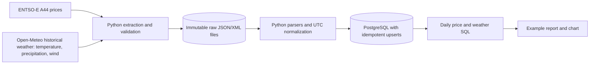

# Energy Data Platform

I built this local data platform to collect Spanish day-ahead electricity prices and historical weather, preserve source responses, load normalized observations into PostgreSQL, and compare their daily patterns. The analysis is descriptive; it does not establish that weather causes price changes.

## Architecture



I use ENTSO-E's Transparency Platform for Spanish day-ahead prices and Open-Meteo's Historical Weather API for hourly weather. ENTSO-E REST access requires an approved account and token. Open-Meteo documents free non-commercial access with request limits and CC BY 4.0 attribution; commercial use requires checking its current plan and terms. See the linked [ENTSO-E API guide](https://transparency.entsoe.eu/content/static_content/Static%20content/web%20api/Guide.html) and [Open-Meteo archive documentation](https://open-meteo.com/en/docs/historical-weather-api).

## Run locally

### Windows (PowerShell)

```powershell
python -m venv .venv
.\.venv\Scripts\Activate.ps1
python -m pip install --upgrade pip
python -m pip install -e ".[dev]"
pre-commit install
Copy-Item .env.example .env
docker compose up -d postgres
```

Edit `.env` with your local settings. Set `WEATHER_TIMEZONE=UTC` to keep the timestamps unambiguous. Add an ENTSO-E token after API access is granted. Open-Meteo does not require a key. Wind speed is requested in metres per second. Fetch one week of weather and load it:

```powershell
python -m energy_platform.ingest --source weather --start 2026-01-01 --end 2026-01-08
$rawFile = Get-ChildItem .\data\raw\open_meteo\2026-01-01_2026-01-08\*.json | Select-Object -First 1 -ExpandProperty FullName
python -m energy_platform.load_weather $rawFile
```

After ENTSO-E access is granted, fetch prices and load the resulting XML:

```powershell
python -m energy_platform.ingest --source electricity --start 2026-01-01 --end 2026-01-08
$priceFile = Get-ChildItem .\data\raw\entsoe\2026-01-01_2026-01-08\*.xml | Select-Object -First 1 -ExpandProperty FullName
python -m energy_platform.load_entsoe_prices $priceFile
```

### Linux and macOS

```bash
python3 -m venv .venv
source .venv/bin/activate
python -m pip install --upgrade pip
python -m pip install -e '.[dev]'
pre-commit install
cp .env.example .env
docker compose up -d postgres
python -m energy_platform.ingest --source weather --start 2026-01-01 --end 2026-01-08
python -m energy_platform.load_weather "$(find data/raw/open_meteo/2026-01-01_2026-01-08 -name '*.json' | head -n 1)"
```

The date range is half-open: `start` is included and `end` is excluded. Open-Meteo expects an inclusive end date, so the extractor adjusts that parameter. Load prices using the same pattern with `python -m energy_platform.load_entsoe_prices <path-to-xml>`. Run checks with `ruff check .` and `python -m pytest`.

After loading both sources, run `python -m energy_platform.report` to query PostgreSQL and generate [`docs/daily_energy_weather.svg`](docs/daily_energy_weather.svg) plus a CSV. The query in [`sql/daily_energy_weather.sql`](sql/daily_energy_weather.sql) groups observations by UTC day and returns interval counts so the daily coverage is visible. The generated chart uses separate scales for price, temperature, and wind. [`docs/example_analysis.md`](docs/example_analysis.md) explains the committed sample result and its limits. [`docs/repository_metadata.md`](docs/repository_metadata.md) contains the suggested GitHub description and topics.

## Technical decisions

- **Raw before normalized:** each API response is stored as a new file under `data/raw/` and is never overwritten. This gives me an audit trail and lets me re-run parsing after code changes.
- **UTC timestamps:** the weather request uses UTC by default and ENTSO-E intervals are parsed as UTC, making daily joins independent of machine timezone. The parser can convert offset-aware weather timestamps. Local naive timestamps in a DST fold or gap are rejected because the source timestamp alone cannot identify a unique instant.
- **Idempotent loads:** PostgreSQL primary keys identify a source observation; `INSERT ... ON CONFLICT DO UPDATE` makes reruns safe and refreshes changed values.
- **Small local stack:** Python and PostgreSQL in Docker Compose keep the project runnable without a paid cloud service. I keep source extraction, parsing, and database writes in separate modules so each can be tested independently.

## Current limitations

- The ENTSO-E parser is tested against a committed sample following the A44 XML structure; I have not verified a live response because API access depends on an approved token.
- Weather records loaded before the wind field was added have `NULL` wind values. Re-fetch the date range and re-run the loader to populate those values.
- The SQL report is a descriptive daily comparison; it does not test correlation or causality. It includes only UTC dates present in both tables. The committed example uses the parser's synthetic price fixture and is not an analysis of live market prices.
- The project does not yet include dbt, Airflow, or an interactive dashboard. PostgreSQL is the only normalized store; GitHub Actions currently runs lint and unit tests.
- Open-Meteo archive values are historical model/reanalysis data, not measurements from a specific local weather station. Weather attribution is required in published outputs: **Weather data by [Open-Meteo.com](https://open-meteo.com/)** under [CC BY 4.0](https://creativecommons.org/licenses/by/4.0/).

## Configuration and data handling

`.env.example` documents local settings. Keep `.env`, API tokens, and downloaded raw responses out of Git; `.gitignore` excludes them. PostgreSQL is exposed on host port `5433` to avoid a conflict with a local PostgreSQL server on `5432`. The raw API response is kept as a separate file per run; normalized rows are updated by their source key, so rerunning a load does not create duplicate intervals.
