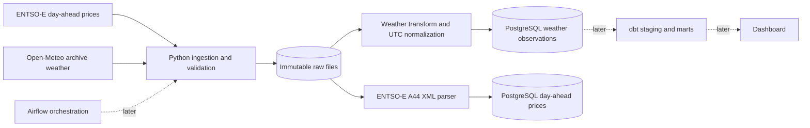

# Energy Data Platform

A local data engineering portfolio project for exploring relationships between Spanish day-ahead electricity prices and weather observations. The analysis compares time series; it does not claim that weather causes price movements.

## Data sources

| Data | Provider | Access and use |
| --- | --- | --- |
| Day-ahead prices, Spain bidding zone | [ENTSO-E Transparency Platform](https://transparency.entsoe.eu/) | Free platform data. REST API access requires a registered account, an access request by email, and a security token. The API is not usable until access is granted. |
| Historical weather observations | [Open-Meteo Archive API](https://open-meteo.com/en/docs/historical-weather-api) | Free for non-commercial use under published request limits. Data is CC BY 4.0 and must be attributed. This portfolio project is assumed to be non-commercial; use a paid plan if that changes. |

The Spanish ENTSO-E bidding zone code used here is `10YES-REE------0`. Source API terms and access rules can change; review the linked provider terms before publishing or using the data commercially. Do not commit API tokens.

## Architecture and roadmap



1. **Phase 1 (complete):** configurable API extraction into a local raw landing zone with request checks and focused tests.
2. **Phase 2 (in progress):** weather and day-ahead price normalization, input checks, and idempotent PostgreSQL upserts; live ENTSO-E verification, broader quality tests, and GitHub Actions remain to do.
3. **Phase 3:** dbt staging/intermediate/mart models and business SQL.
4. **Phase 4:** Airflow DAGs, retries, structured logs, and run metrics.
5. **Phase 5:** dashboard, representative output screenshots/examples, and portfolio polish.

The present phase intentionally stops at raw ingestion. It does not claim that transformed data or a dashboard already exists.

## Windows setup (PowerShell)

Install Python 3.11+, Git, Docker Desktop, and VS Code. From the repository folder:

```powershell
python -m venv .venv
.\.venv\Scripts\Activate.ps1
python -m pip install --upgrade pip
python -m pip install -e ".[dev]"
Copy-Item .env.example .env
```

Open `.env` and set `ENTSOE_API_TOKEN` after requesting and receiving ENTSO-E REST access. Never commit `.env`. Open-Meteo does not need a key. The default weather coordinates are Madrid and can be changed in `.env`.

Start local PostgreSQL:

```powershell
docker compose up -d postgres
docker compose ps
```

The Compose service reads its local database settings from `.env`. It publishes PostgreSQL on host port `5433` to avoid conflicts with a local PostgreSQL installation on port `5432`. If you created `.env` before the database variables were added to `.env.example`, copy the `POSTGRES_DB`, `POSTGRES_USER`, `POSTGRES_PASSWORD`, and `DATABASE_URL` entries into it.

Download weather for a half-open date range `[start, end)` (no API key required):

```powershell
python -m energy_platform.ingest --source weather --start 2026-01-01 --end 2026-01-08
```

Download ENTSO-E day-ahead prices once API access is enabled:

```powershell
python -m energy_platform.ingest --source electricity --start 2026-01-01 --end 2026-01-08
```

Use `--source all` to attempt both. Raw payloads are written under `data/raw/<source>/<start>_<end>/<run-id>.<format>`. Each run receives a unique file, so a re-fetch does not overwrite the previous source response. No data files or credentials belong in Git.

Load a landed weather response into PostgreSQL (replace the path with a JSON file from your raw folder):

```powershell
$rawFile = Get-ChildItem .\data\raw\open_meteo\2026-01-01_2026-01-08\*.json | Select-Object -First 1 -ExpandProperty FullName
python -m energy_platform.load_weather $rawFile
```

The loader creates `weather_observations` if needed. Its primary key is `(source, observed_at, latitude, longitude)`. If a row with that key already exists, the UPSERT updates its measurement values instead of inserting a duplicate. Weather timestamps are converted to UTC before storage.

Load the local ENTSO-E A44 XML fixture into PostgreSQL without an API token:

```powershell
python -m energy_platform.load_entsoe_prices .\tests\fixtures\entsoe_a44_a03_sample.xml
```

The loader creates `day_ahead_prices` if needed. Its primary key is `(source, area_code, delivery_start)`, and it stores currency and price unit with each interval. Re-running the fixture load updates matching rows instead of duplicating them.

Run unit tests:

```powershell
python -m pytest
```

## Current limitations

- The raw API response is retained unchanged; normalized weather rows can be loaded into PostgreSQL with the separate loader command.
- The ENTSO-E parser and PostgreSQL loader are covered by a synthetic fixture based on the published XML structure; the live response still needs verification after API access is granted.
- ENTSO-E access requires the user's own approved token. Do not paste the token into chat or source files.
- Weather is historical model/reanalysis data served by Open-Meteo, not a claim of a local official weather station observation.
- Dashboard, Airflow, dbt, CI, normalized analytics, and representative query results are planned phases, not completed features.

## Attribution

When displaying weather data, include **Weather data by [Open-Meteo.com](https://open-meteo.com/)** and the [CC BY 4.0 license](https://creativecommons.org/licenses/by/4.0/). Cite ENTSO-E as the source for market data and follow its current terms.
